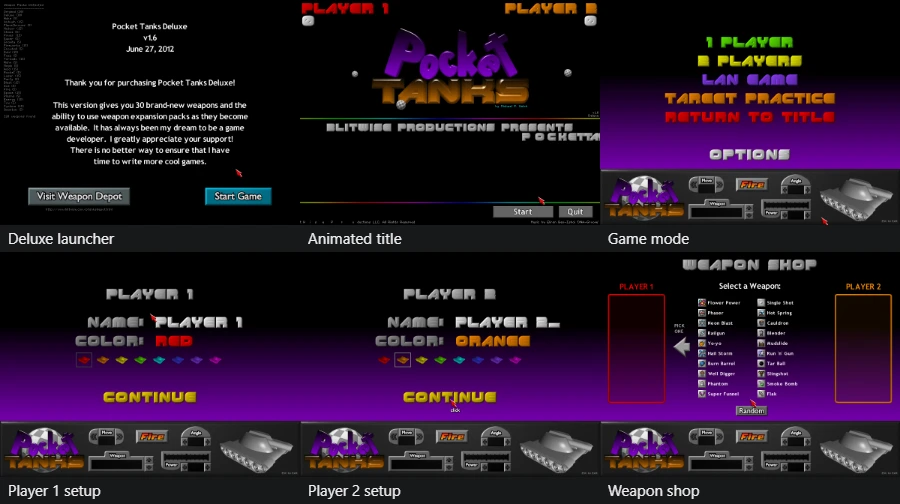

# Deluxe presentation audit

Four instrumented runs of the original Windows executable produced 9,489 presented frames and 107 audio-start calls. Two native browser runs produced 1,291 rendered frames. These counts describe the recordings. Pixel comparisons use the frame regions and alignment rules below.

[Step through the Single Shot comparison](https://saikhurana98.github.io/pocket-tanks-native/tests/frame-review.html)



| Sequence | What the comparison showed |
| --- | --- |
| Launcher → title → mode selection | The PC displays the Deluxe launcher, animates the logo and bouncing balls, and sounds a click, a title-start cue and separate bounce samples. The browser opens on a playable range or shop. These screens, their music sequence and the transition animations remain open. |
| Two-player setup → shop | The PC steps through both players' names and colors and animates the menu lettering. The native two-player shortcut skips both screens. |
| Manual pick → Random | On PC, one manual pick left 19 items. Each of the next 19 pick sounds coincided with the first presented frame showing one fewer weapon in the center. The native browser now draws those 19 deals individually, plays the same samples, and displays the original Random button art and busy cursor. The departing shop lettering and field entrance remain open. |
| Open inventory → select | The same pointer path selected Quad Missile on PC and Single Shot on the web. The PC popup region produced 22 distinct images while opening and the web produced 3. The native port now plays the original open and selection clicks. Popup scrolling, pointer handling and the transition still differ. |
| Aim and power | The 60° to 59° change ended with identical readout pixels. Two native readout states covered 58 of 59 original frames. The 20 to 21 power change matched both original states in order across all 56 original frames. The PC also clicks when entering and committing slider adjustment. Those cues now play on the web. |
| Move | The PC pulses the movement count yellow. Its 42 × 20 readout produced 77 distinct images during the 279-frame input segment. The native readout stayed white. The movement click is restored. |
| Fire → travel → impact | The captured Single Shot played cannon.wav and expmedium2.wav. The separate inventory run fired Quad Missile and played cannon.wav and explong.wav. The motion comparison below measures Single Shot at the recorded update counters. |
| Falling terrain → next turn | The original plays successive rock samples while columns are falling. Native soil updates now drive that sequence. A sustained-fall test covers all six samples, rollover, silence, and restart. Full-screen terrain and next-turn arrow animation timing remain open. |
| End-game prompt → cancel or confirm | Escape opens the prompt on PC. All 22,800 pixels of the settled prompt match the native render. The original clicks on open, cancel and confirm. Those cues are restored. Confirming on PC restarts the animated title. The web currently displays its restart control. |
| Match result and rematch | The native browser regression plays all 20 shots, completes the scoring flow, and starts a rematch. The match-result animation has not received a synchronized PC frame comparison. |

## Single Shot in motion

Two measurements answer different questions.

- **Projectile and impact together.** The viewer replays the captured range at 60° and power 20. Of 57 original 60 × 60 pixel crops, 8 match exactly at the recorded physics counters. There are 9,985 differing pixels across the 205,200 compared. The first sample differs in 16 pixels at flight update 9. These older captures read the screen from a browser animation callback, so the result includes any delay between the screen image and the sampled simulation state. The viewer preserves that timing.
- **Explosion at presentation.** A fresh run samples the framebuffer at the original display boundary and records the explosion counter on that same call. The native replay matches 29 of 35 explosion-color masks exactly. The remaining six frames differ by 12 pixels in total, with a maximum of three in a frame. This measures the 46 × 46 explosion region and its palette. The surrounding scene is outside this comparison.

## Evidence and reproduction

The reference process ran the original Pocket Tanks Deluxe 1.6 executable with SHA-256 `8e50050faba34a18d47c6f314486ef2888e4552ab18095e3bb517ecffbb34caa`. The reference harness intercepted the final 800 × 600 framebuffer presentation, and associated BASS sample handles with the filenames loaded by the executable. An unlabelled channel start is kept as `channel`. The browser hook counted decoded-sample starts. Neither hook measures speaker output or proves identical mixing, volume, or device latency.

The falling-terrain routine at `0x447d10` scans columns at 30 Hz. The playback branch at `0x448046` advances the sound clock during active scans, cycles six slots every 0.774 seconds, and primes the first slot after inactivity. In the random draft, playback returns at `0x46eaec`. The original run took 1.992 seconds from the Random click cue to the nineteenth automatic pick. Browser scheduling and the reference recorder affect wall-clock measurements.

The [compressed recording index](tests/captures/presentation-timelines.json.gz) includes every observed presentation and audio-start event for the four PC routes and two native routes. Each frame row contains elapsed milliseconds, input-segment index, two simulation counters, and 32-bit FNV-1a signatures for the field and HUD. Each 32-bit RGBA pixel is one hash input. PC counters count bullet and explosion updates. Native counters count active bullets and explosions. Segment labels mark inputs, which can precede the visible response. Different terrain, random drafts, and display rates preclude a meaningful whole-screen subtraction between independent sessions.

Run the following against a served checkout. Set PLAYWRIGHT_MODULE to a playwright-core installation and EDGE_PATH to a Chromium executable when needed.

```sh
node tests/presentation-flow.cjs http://127.0.0.1:8213/
node tests/browser.cjs http://127.0.0.1:8213/
```

The first test checks the shot crops against their current per-frame difference ceilings, the presentation-boundary blast masks, control pixels, the audible deal sequence, mid-deal reset and rock-sound cadence. The second exercises actual browser gameplay through rematch. CPU play, LAN, options, all weapon-specific effects and the remaining Deluxe weapons are outside these recordings.

The Windows Playwright WebKit build exposes no Web Audio context. It requests the correct HTML audio files, but its play promises remained pending in this environment. Audible WebKit playback still needs verification on a device with an active audio backend.
